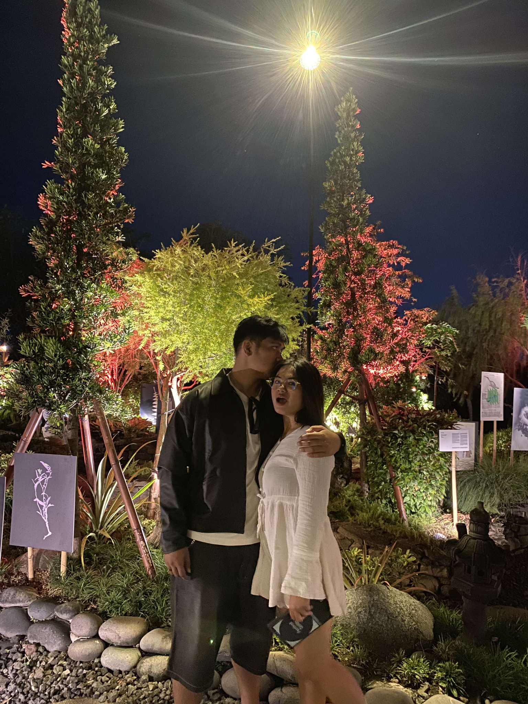
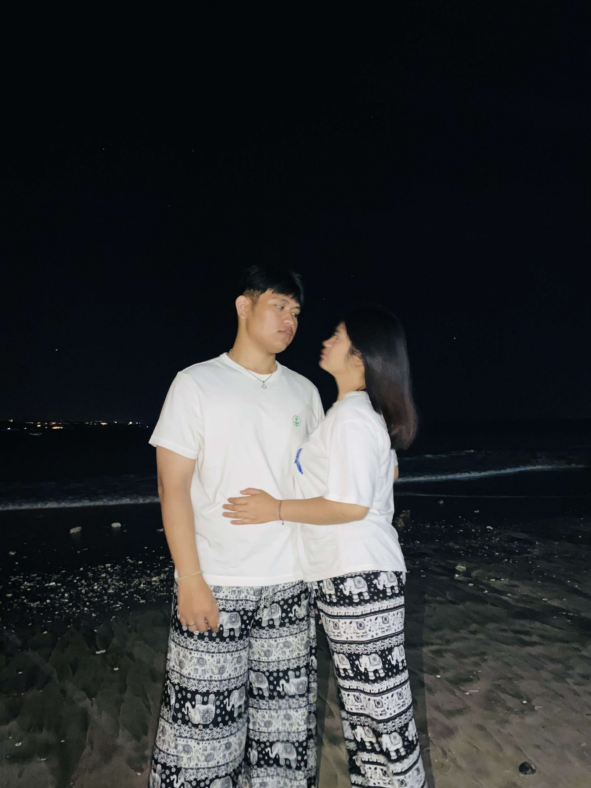
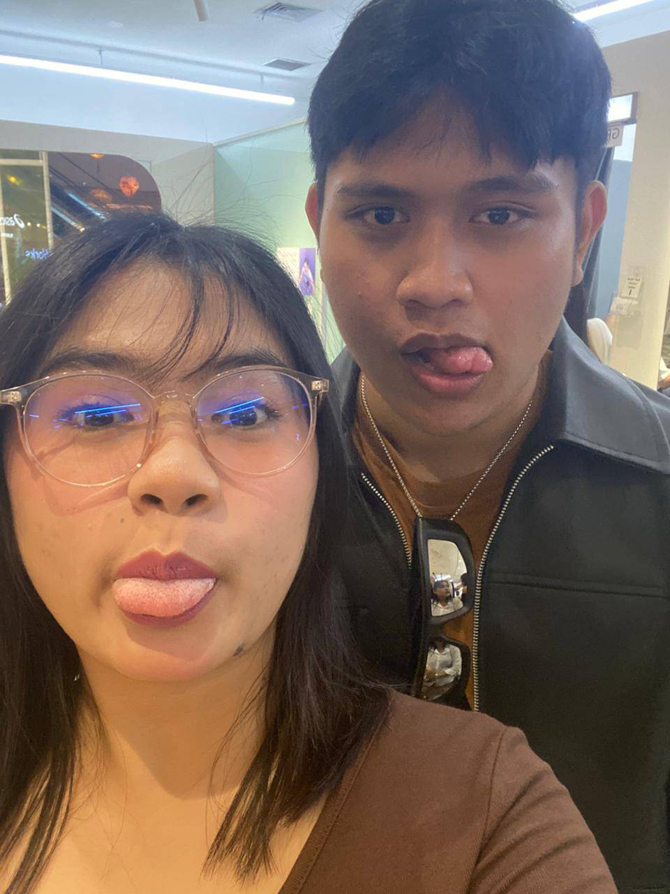

# YogaPutu-love
hmmm kepo deh
<!DOCTYPE html>
<html lang="id">
<head>
  <meta charset="UTF-8">
  <meta name="viewport" content="width=device-width, initial-scale=1.0">
  <meta name="theme-color" content="#6f4936">
  <title>Surat Kecil untuk Putu Sri Anjani ♡</title>
  <link rel="preconnect" href="https://fonts.googleapis.com">
  <link rel="preconnect" href="https://fonts.gstatic.com" crossorigin>
  <link href="https://fonts.googleapis.com/css2?family=Cormorant+Garamond:wght@400;500;600;700&family=Dancing+Script:wght@400;500;600;700&display=swap" rel="stylesheet">
  
</head>
<body>
  <main class="paper">
    
✦ ❧ ✦

    
A little letter from my heart

    <h1>Untuk Putu Sri Anjani</h1>
    
──────── ♡ ────────

    

      Ada sesuatu yang ingin aku sampaikan. Mungkin sederhana,
      tapi aku berharap kamu bisa merasakan ketulusan di dalamnya.
    

    <section class="envelope-wrap" aria-label="Amplop surat">
      <button class="envelope" id="envelope" aria-label="Buka amplop surat" onclick="openEnvelope()">
        
        Untuk Putu ♡<small>PLEASE OPEN</small>
        
        
        ♥
      </button>
      
Klik amplopnya untuk membuka surat kecil ini.

    </section>

    
❦

    <h2>Potongan Kenangan Kita</h2>
    
Beberapa momen kecil yang ingin aku simpan dengan baik.

    <section class="photo-grid" aria-label="Galeri foto kenangan">
      

        
        
A night to remember ♡

      

      

        
        
Just you and me

      

      

        
        
Our silly little moments

      

    </section>

    

      Setiap orang pasti pernah melakukan kesalahan, termasuk aku.
      Tapi aku nggak ingin menjadikan itu alasan untuk mengabaikan perasaanmu.
    

    

      Aku ingin belajar dari kesalahanku, lebih mendengarkan,
      dan menunjukkan perubahan lewat sikap, bukan cuma kata-kata.
    

    

      <button onclick="toggleLetter()" id="letterButton">💌 Buka Suratku</button>
      <label for="photoInput" class="upload-label">📷 Ganti Foto</label>
      <input id="photoInput" type="file" accept="image/*" hidden>
    

    
Ganti Foto mengubah foto pertama untuk pratinjau saja. Untuk mengganti foto permanen, ikuti tutorial.

    <section class="letter" id="letter">
      <h2>Dear Putu...</h2>
      

        Aku mau minta maaf ya, Putu Sri Anjani. Maaf kalau perkataan
        atau sikapku pernah bikin kamu sedih, kecewa, atau merasa nggak dihargai.
      

      

        Aku mungkin belum selalu bisa memahami perasaanmu dengan baik.
        Tapi aku ingin belajar, memperbaiki diri, dan lebih menghargai
        apa yang kamu rasakan.
      

      

        Aku nggak berharap semuanya langsung baik-baik saja. Aku cuma
        ingin kamu tahu kalau permintaan maaf ini tulus dari hati.
      

      

        Terima kasih sudah menjadi bagian dari cerita hidupku.
        Aku harap kita bisa bicara baik-baik, dan aku akan menghargai
        perasaan serta waktumu.
      

      
Maaf ya, untuk hal-hal yang pernah membuat hatimu terluka.

      
Maafin aku ya, Putu. ♡

    </section>

    

      <button class="secondary" onclick="showFinalMessage()">🤎 Pesan Terakhir</button>
    

    

    
♫

    <h2>Our Little Song</h2>
    
Putar musik sambil membaca surat ini.

    

      <audio id="music" controls loop preload="metadata">
        <source src="assets/musik.mp3" type="audio/mpeg">
        Browser kamu tidak mendukung pemutar audio.
      </audio>
      

        <label for="musicInput" class="upload-label">🎵 Pilih Musik dari Perangkat</label>
        <input id="musicInput" type="file" accept="audio/*" hidden>
      

      
Jika musik belum ada, pilih file lagu dari perangkatmu.

    

    

      Dibuat dengan tulus dan sepenuh hati ♥ 
      Untuk Putu Sri Anjani  
      <em>Some feelings are better written from the heart.</em>
    

  </main>

  
</body>
</html>
